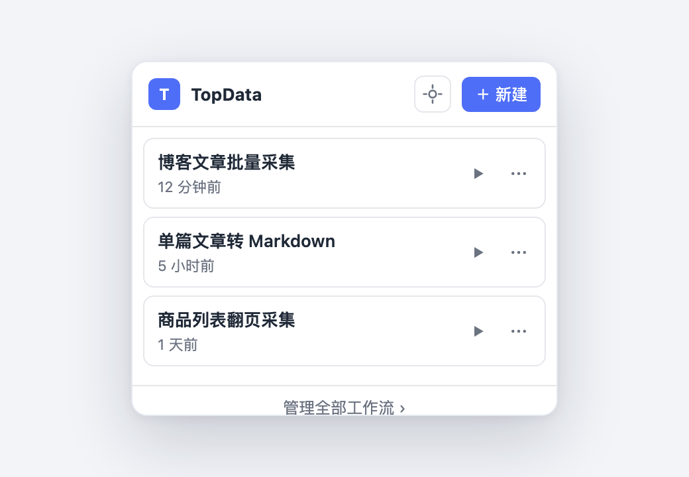
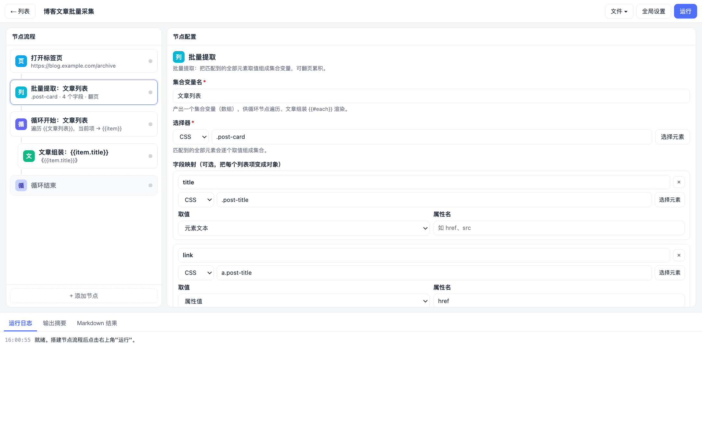
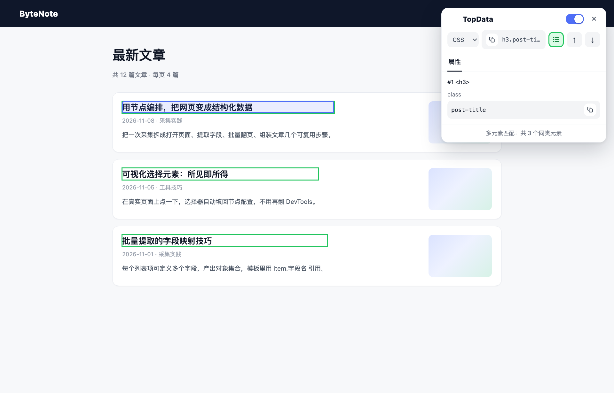
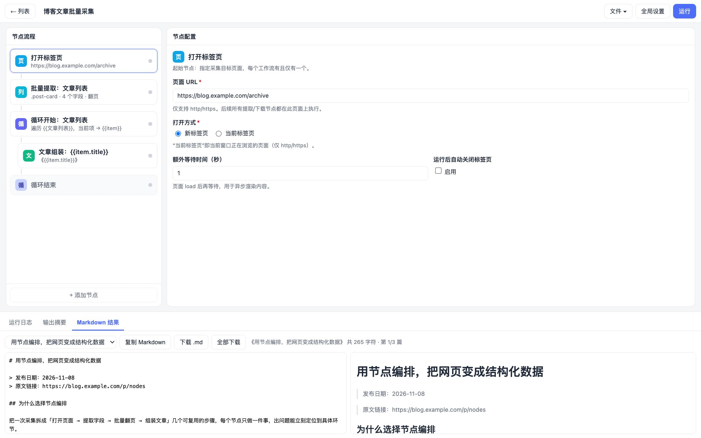
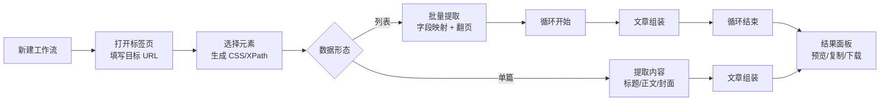

# TopData · 节点编排式网页采集

> 打开网页 → 提取文本 / 属性 / 图片 → 组装成 Markdown，一键复制或批量下载。
> Chrome 扩展（Manifest V3）· 原生 HTML/CSS/JS · 零依赖 · 无需构建



<p align="center"><sub>浏览器工具栏弹窗：工作流列表，支持运行、重命名、删除、新建</sub></p>

---

## 一、这个应用是干什么的

TopData 是一个装在 Chrome 里的**网页内容采集器**。它把"抓取网页"这件事拆成一串可复用的**节点**：

```
打开标签页 → 提取内容 / 批量提取 / 下载图片 → 循环 / 条件 → 文章组装 → 导出 Markdown
```

你不需要写代码，只需要在页面上点几下拿到 CSS 选择器，把节点连起来，就能把任意文章、商品列表、资讯流变成干净的结构化数据（Markdown / JSON 变量），并且可以保存成"工作流"反复使用。

**典型场景**

| 场景 | 做法 |
| --- | --- |
| 把一篇公众号 / 博客文章存成 Markdown | 打开页面 → 提取标题、正文、封面 → 组装 |
| 采集一个列表页的全部条目并翻页 | 批量提取（字段映射 + 翻页）→ 循环 → 组装 |
| 批量下载某个页面的所有图片 | 批量提取图片地址集合 → 循环 → 下载图片 |
| 定期整理竞品资讯 | 保存工作流，改个 URL 直接再跑一遍 |

---

## 二、功能一览

### 1. 工作流管理

- 工作流列表（弹窗 + 全页编辑器主页），按更新时间排序，显示节点数量与相对时间
- 运行、重命名（内联编辑）、删除（二次确认）
- 新建工作流时自动带上"打开标签页"起始节点
- **导入 / 导出 JSON**：可导出单个或全部工作流，导出文件带 `version` 与 `exportedAt`，方便备份与分享

### 2. 节点链编辑器

左侧是节点链（支持块级缩进显示循环 / 条件嵌套），右侧是选中节点的配置表单，底部是运行日志 / 输出摘要 / Markdown 结果三块面板。



<p align="center"><sub>左侧节点链 · 右侧节点配置（批量提取的字段映射，每个字段都可点「选择元素」）· 底部运行日志</sub></p>

| 节点 | 作用 |
| --- | --- |
| **打开标签页** | 指定目标 URL，新标签页或当前标签页打开，支持额外等待、运行后自动关闭 |
| **提取内容** | 用 CSS / XPath 取元素文本或属性值，支持多匹配、等待元素、未匹配处理、正则替换 |
| **批量提取** | 匹配一组元素产出**集合变量**，可定义字段映射把每项变成对象，支持点击"下一页"翻页采集 |
| **下载图片** | 按选择器或变量取图片地址，下载到本地（引用相对路径）或直接引用原始 URL |
| **循环开始 / 结束** | 遍历集合变量，循环体内的节点逐项执行，可一次产出多篇结果 |
| **条件分支 / 结束** | 8 种判断（不为空、为空、等于、不等于、包含、不包含、大于、小于），条件不成立整段跳过 |
| **文章组装** | `{{变量}}` 模板渲染 Markdown，支持 `{{#each 集合}}…{{/each}}` 与 `{{item.字段}}` |

### 3. 三种多匹配策略

提取节点遇到多个匹配元素时，可以按需选择：

- **仅第一个**：只取第一个匹配项（适合标题、作者）
- **全部（拼接）**：全部匹配项按分隔符拼成一个字符串（适合正文段落）
- **列表集合（返回 list）**：把全部匹配项存成数组，交给循环节点逐项处理，或在模板里 `{{#each}}` 渲染

### 4. 批量提取 + 字段映射

- 匹配到的每个元素可以定义多个字段（字段名 / 选择器 / 取值 / 属性名），产出**对象集合**
- 字段的「选择元素」按钮直接在网页上点选，自动生成**相对当前列表项**的选择器（如 `.item-name`），不用手写
- 内置"怎样填写"说明与完整示例，字段留空表示取列表项元素本身
- 翻页采集：填写"下一页"选择器 + 最大页数 + 每页等待时间，自动点击翻页并合并去重

### 5. 可视化选择浮层

点弹窗右上角的准星图标（或编辑器里的「选择元素」），会在当前网页注入一个**可拖动的选择面板**：



<p align="center"><sub>可拖动浮层：CSS / XPath 切换、属性复制、多元素匹配（同类元素绿色高亮）</sub></p>

- 实时高亮鼠标下的元素，点击即选中并生成选择器
- CSS 与 XPath 一键切换，选择器可直接复制
- 列出元素全部属性，单独复制某个属性值
- **多元素匹配**：开启后同类元素全部绿色描边，一眼看出"批量提取"会抓到几项

### 6. 结果输出



<p align="center"><sub>Markdown 源码 + 实时预览双栏，多篇结果可下拉切换、单篇下载或全部下载</sub></p>

- 运行成功后在「Markdown 结果」页展示源码与渲染预览
- 循环内组装会产出多篇结果：下拉切换、复制、下载 `.md`、全部下载
- 「输出摘要」页集中展示本次运行的所有变量值，便于调试选择器

---

## 三、亮点

1. **零依赖、零构建**：纯原生 JS + HTML + CSS，改完刷新扩展即可生效，没有 npm / webpack / 框架负担。
2. **节点编排而不是写脚本**：逻辑可视化，流程一眼看清；出错时能精确知道是哪个节点、哪种原因（状态点区分成功 / 空 / 失败 / 跳过）。
3. **选择器"所见即所得"**：可拖动浮层 + 同类元素高亮 + 相对列表项点选，基本不需要打开 DevTools。
4. **一份工作流跑出多篇结果**：循环 + 文章组装，天然支持列表批量转 Markdown。
5. **产出直接可用**：Markdown 源码 / 预览 / 复制 / 下载一次到位，导入导出 JSON 便于团队共享。
6. **隐私友好**：所有数据只存在 `chrome.storage.local` 本地，无服务端、无上报。
7. **错误容忍度可配**：每个提取节点都能设置"未匹配时停止或置空继续"，批量任务不会被单个坏字段打断。

---

## 四、典型使用流程



---

## 五、项目结构

```text
web-collector-extension/
├── manifest.json                 # MV3 清单：名称、权限、弹窗入口、图标
├── Readme.md
├── icons/                        # 扩展图标 16 / 32 / 48 / 128
│   ├── icon16.png
│   ├── icon32.png
│   ├── icon48.png
│   └── icon128.png
├── popup/                        # 工具栏弹窗
│   ├── popup.html                # 工作流列表 + 新建 + 选择元素入口
│   ├── popup.css
│   └── popup.js                  # 列表渲染、运行、重命名、删除、注入浮层
├── editor/                       # 全页编辑器（实际执行环境）
│   ├── editor.html               # 主页 + 编辑视图 + 设置弹窗
│   ├── editor.css
│   └── editor.js                 # 节点渲染、配置表单、校验、执行引擎、Markdown 渲染
├── common/                       # 弹窗与编辑器共享
│   ├── store.js                  # WCAStore：chrome.storage.local 读写与数据迁移
│   └── inspector.js              # 页面可视化选择浮层（Shadow DOM）
└── docs/
    ├── chrome-collector-extension-prd.md   # 产品需求文档（功能权威说明）
    └── screenshots/                       # README 截图
```

---

## 六、技术栈

| 分类 | 选型 | 说明 |
| --- | --- | --- |
| 扩展规范 | **Chrome Extension Manifest V3** | `action` 弹窗 + 全页扩展页面 |
| 语言 | **原生 JavaScript (ES2017+)**、HTML5、CSS3 | 无框架、无打包器、无第三方依赖 |
| 存储 | `chrome.storage.local` | 单个 `state` key：`{ workflows, settings }`，含旧版本自动迁移 |
| 页面注入 | `chrome.scripting.executeScript` | 注入自包含函数（不可引用外部变量），回传选择结果 |
| 标签页控制 | `chrome.tabs` | 打开 / 复用标签页、等待 `status === 'complete'` |
| 文件下载 | `chrome.downloads` | 图片与 `.md` 文件下载 |
| UI 隔离 | **Shadow DOM** | 选择浮层与宿主页面样式完全隔离 |
| 样式 | CSS 变量 + Flexbox | `--primary / --text / --border` 等主题变量 |
| Markdown | 手写轻量渲染器 | 支持标题、列表、引用、代码块、图片、链接、表格等常用语法 |
| 数据格式 | JSON（带 `version` 的导出结构） | 工作流导入导出、版本升级兼容 |

> 权限声明：`tabs`、`scripting`、`downloads`、`storage`，以及 `host_permissions: <all_urls>`（因为目标站点由用户自己填写）。

---

## 七、本地安装与启动

### 方式一：加载已解压的扩展（推荐，1 分钟）

1. 获取代码：

   ```bash
   git clone https://gitee.com/kenhins/web-collector-extension.git
   ```

   或直接下载 ZIP 解压。

2. 打开 Chrome，地址栏输入 `chrome://extensions/`：
3. 右上角打开 **开发者模式**；
4. 点击 **加载已解压的扩展程序**，选择包含 `manifest.json` 的目录（即 `web-collector-extension/`）；
5. 在工具栏的扩展菜单里把 **TopData** 固定到工具栏，点击图标即可使用。

> Edge / 其他 Chromium 内核浏览器同理，扩展管理页地址分别为 `edge://extensions/` 等。

### 方式二：开发调试

- 修改代码后，回到 `chrome://extensions/` 点击扩展卡片上的 **刷新** 按钮；
- 调试弹窗：右键扩展图标 → **审查弹出内容**；
- 调试编辑器：在扩展页面里按 `F12`（编辑器是独立标签页，可直接用 DevTools）；
- 调试注入的选择浮层：在目标网页的 DevTools 中查看 `#__topdata_inspector_host__` 的 Shadow Root。

### 验证是否安装成功

点击工具栏图标，能看到工作流列表弹窗，并可以点「＋ 新建」进入编辑器，即为安装成功。

### 导入示例工作流

仓库自带两个示例（`docs/data/TopData.json`、`docs/data/GetData.json`）：

1. 打开编辑器 → 右上角「文件 ▾」→ **导入工作流…**；
2. 选择示例 JSON；
3. 把「打开标签页」节点里的 URL 换成你要采集的页面，按需调整选择器，然后点「运行」。

---

## 八、3 分钟上手：把一篇文章转成 Markdown

1. **新建工作流**，在「打开标签页」里填入文章 URL；
2. **添加节点 → 提取内容**，变量名填 `标题`，点「选择元素」，在页面上点一下文章标题；
3. 再加一个「提取内容」，变量名 `正文`，选择器选 `.article-body p`，多匹配处理选 **全部（拼接）**；
4. **添加节点 → 文章组装**，标题填 `{{标题}}`，模板写：

   ```markdown
   # {{标题}}

   {{正文}}
   ```

5. 点击右上角 **运行**，等日志全部变绿，切到「Markdown 结果」页即可复制或下载。

需要整页列表时，把第 2 步换成「批量提取」：选择器指向列表项（如 `.post-card`），在字段映射里加 `title`、`link` 等字段，逐个点「选择元素」；再套一层「循环开始 / 循环结束」，把文章组装放进循环体，就能一次产出多篇。

---

## 九、优缺点

### 优点

- **上手成本低**：可视化选择器 + 中文表单 + 内联说明，不写代码也能采集。
- **结构清晰可维护**：节点链 + 状态点 + 日志，流程与故障点一目了然。
- **能力覆盖主流需求**：单篇、列表、翻页、图片、循环、条件、模板组装都能覆盖。
- **轻量**：无依赖、无构建、无后端，安装即用，代码量小易二次开发。
- **数据本地化**：所有配置存在本地浏览器，不上传任何内容。
- **可迁移**：工作流可导出 JSON，换设备 / 分享给别人直接导入。

### 缺点与限制

- **只适配静态与轻交互页面**：依赖 DOM 选择器；纯 Canvas 渲染、强加密接口、需登录鉴权的页面无法直接采集。
- **不支持复杂反爬**：不做 UA / 指纹伪装、不处理验证码，遇到强风控站点需要人工介入。
- **翻页能力有限**：仅支持"点击下一页不刷新整页"的场景；整页跳转式分页需要拆成多个工作流。
- **强依赖选择器稳定性**：站点改版后工作流需要重新点选维护。
- **仅 Chrome / Chromium 系**：基于 MV3 专有 API，不能直接跑在 Firefox / Safari。
- **没有单元测试与 CI**：当前以手工回归为主，改动核心执行引擎时需自行验证。
- **结果面板不持久化**：运行结果只在当前标签页内有效，刷新后需重新运行。

---

## 十、常见问题

**Q：点击「选择元素」提示"当前标签页不是普通网页"？**
A：选择浮层只能注入 `http/https` 页面，请先切到目标网页再点。

**Q：运行报"未匹配到元素"？**
A：先用「选择元素」的**多元素匹配**确认选择器能匹配到几个；内容异步渲染时把该节点的"等待元素出现"调大，或在「打开标签页」加额外等待。

**Q：正文只能抓到第一段？**
A：把“多匹配处理”改成 **全部（拼接）**，并填写合适的分隔符（通常是空行）。

**Q：想抓列表里每一项的多个字段？**
A：用「批量提取」，在字段映射里逐项添加字段并点「选择元素」；选择器会自动写成相对列表项的写法。

**Q：图片下载到哪里了？**
A：默认在浏览器下载目录下的 `web-collector/images`，可在「全局设置」里改子文件夹名。

**Q：「列表集合」有什么特别？**
A：它返回数组而不是字符串，配合循环节点可逐项处理，也能在模板里用 `{{#each 集合名}}{{item.字段}}{{/each}}` 直接渲染表格或清单。

---

## 十一、许可证

仓库暂未附带 LICENSE 文件，如需商用或二次分发，请先与作者确认授权方式。

---

<sub>界面截图使用演示数据，实际使用时目标页面与工作流由你自己配置。</sub>
